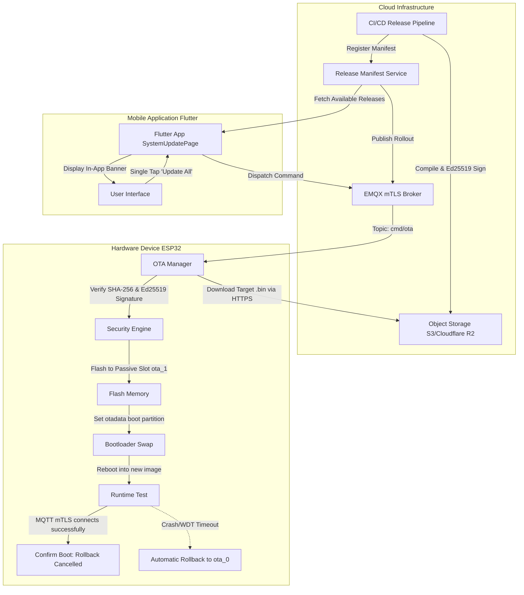

# EH Home — Commercial Firmware & App Update Architecture (OTA)

## 1. Executive Summary

A commercial-grade smart home product requires a seamless, zero-anxiety update experience for both:
1. **The Mobile Application (Flutter):** Delivered via App Store / Google Play Store with in-app notifications and background checks.
2. **The IoT Hardware Devices (ESP32 / ESP32-C6):** Delivered over-the-air (OTA) via signed dual-slot HTTPS swap with automatic failover, anti-rollback protection, and zero user disruption.

When updates are effortless, transparent, and non-destructive, users feel confidence and pride in owning the product.

---

## 2. The Dual-Layer Update Model



---

## 3. How the Hardware Device Updates Over-the-Air (OTA)

### Step 1: Automated Release Packaging & Cryptographic Signing
1. When firmware is built for release (`scripts/firmware_pipeline.js`), it generates `eh-smart-switch-app.bin`.
2. The manufacturing PKI signs the SHA-256 digest of the binary using the private Ed25519 key:
   $$\text{Signature} = \text{Ed25519Sign}(\text{PrivateKey}_{\text{mfg}}, \text{SHA256}(\text{Binary}))$$
3. The binary is uploaded to an authenticated HTTPS object store CDN (e.g. Cloudflare R2 / AWS S3).
4. The database registers the release manifest:
   ```json
   {
     "firmwareFamily": "esp32c6-switch-platform",
     "version": "1.1.0",
     "minVersion": "1.0.0",
     "downloadUrl": "https://ota.ehhome.io/builds/v1.1.0/switch-app.bin",
     "sha256": "4a5b6c...",
     "ed25519Signature": "9f8e7d...",
     "binarySizeBytes": 1048576,
     "releaseNotes": "Enhanced switch debounce and instant local UDP responsiveness."
   }
   ```

### Step 2: Device Notification & Rollout Waves
- Commercial releases are not pushed to 100% of devices at once. The fleet engine uses **phased rollout cohorts**:
  - **Canary:** 5% of devices (internal/beta homes).
  - **Early Adoption:** 25% of devices.
  - **General Availability (GA):** 100% of devices.
- The cloud dispatches an MQTT command on `eh/{deviceId}/cmd/ota` containing the manifest.

### Step 3: Zero-Risk Dual-Slot Partition Swap
The ESP32 flash table contains two equal application slots (`1792 KB` each):
- `ota_0` (Currently running active slot)
- `ota_1` (Passive dormant slot)

1. **Anti-Rollback Verification:** `ota_manager.c` verifies the incoming semver is $\ge$ the currently running version. Downgrading to vulnerable firmware is rejected.
2. **Streaming Download:** The device streams the binary over HTTPS directly into `ota_1` while the house switches continue functioning.
3. **Integrity & Signature Check:** Before applying, the complete binary's SHA-256 hash and Ed25519 signature are cryptographically checked against the vendor public key embedded in the bootloader.
4. **Boot Swap:** The `otadata` partition is updated to point to `ota_1`. The device reboots safely (<3 seconds).

### Step 4: Automatic Self-Healing Rollback Guard
What happens if the device loses power mid-reboot, or the new firmware has a bug that prevents network connection?
- The ESP-IDF bootloader marks the new slot as `ESP_OTA_IMG_PENDING_VERIFY`.
- The device boots the new firmware and attempts to connect to Wi-Fi and MQTT.
- Only when mTLS handshake succeeds does the app call `ota_manager_confirm_boot_valid()`, permanently marking `ota_1` as `ESP_OTA_IMG_VALID`.
- **If the watchdog expires or it fails to connect within 60 seconds:** The bootloader automatically reverts to the previous known-working slot (`ota_0`). **The device is 100% immune to bricking.**

---

## 4. How the User Experiences Updates in the Mobile App

In consumer IoT products, confusing update interfaces create frustration. EH Home makes it rewarding and simple.

### The System Update Section (`features/updates/presentation/system_update_page.dart`)

```text
┌────────────────────────────────────────────────────────┐
│  ←  System Update                                      │
├────────────────────────────────────────────────────────┤
│  🟢 Everything is Up to Date                          │
│  Your app and 3 connected devices are running          │
│  the latest software.                                  │
│                                                        │
│  Last checked: Today, 8:45 PM              [Check Now] │
├────────────────────────────────────────────────────────┤
│  TARGETS IN THIS HOME                                  │
│                                                        │
│  📱 EH Home App                           v1.0.0       │
│     Mobile controller application         Up to Date   │
│                                                        │
│  ⚡ Living Room 3X Switch                  v1.0.0       │
│     Hardware model: EH-SW-3X              Up to Date   │
│                                                        │
│  🔌 Kitchen 2X Socket                     v1.0.0       │
│     Hardware model: EH-SK-2X              Up to Date   │
├────────────────────────────────────────────────────────┤
│  UPDATE PREFERENCES                                    │
│                                                        │
│  Auto-Update Devices Overnight             [Toggle ON] │
│  Updates install automatically between 2 AM - 4 AM.    │
│                                                        │
│  Update Release Notes History                      >   │
└────────────────────────────────────────────────────────┘
```

### When an Update is Available:
1. **Friendly Banner on Dashboard:** A non-intrusive card appears on the Home Page:
   *"Firmware v1.1.0 is ready for your Living Room Switch (Improves touch response)."*
2. **User Has Full Control:**
   - **Option A:** Tap **"Update Now"** — A smooth progress sheet displays:
     - *"Downloading update (45%)..."*
     - *"Verifying cryptographic signature..."*
     - *"Rebooting switch (reconnecting in 3s)..."*
     - *"Success! Switch updated to v1.1.0."*
   - **Option B:** **"Schedule for Tonight"** — Installs automatically at 3:00 AM while the household is asleep.
3. **App Updates (Play Store / App Store):**
   - The Flutter app integrates the Google Play In-App Update API and Apple StoreKit.
   - When a major new app version is available, an in-app card invites the user to update without having to search the app store manually.

---

## 5. Commercial Implementation Roadmap: Building the Feature

To build this end-to-end for production, the monorepo provides all underlying hooks:

| Layer | Component | Status in Monorepo | Next Step |
| :--- | :--- | :--- | :--- |
| **Firmware** | `ota_manager.c` | **Completed** | Handles HTTPS download, SHA-256, Ed25519 signature, and boot confirmation. |
| **Backend** | `firmware-release.service.js` | **Completed** | Tracks releases, semantic versions, and hardware compatibility. |
| **Transport** | `mqtt_transport` | **Completed** | Dispatches `cmd/ota` and receives `evt/ota_progress` receipts. |
| **Mobile App** | `system_update_page.dart` | **Completed** | Full dynamic UI for checking app & device updates. |
| **Cloud CDN** | Object Storage bucket | Infrastructure Phase | Wire MinIO/Cloudflare R2 storage bucket for public HTTPS binary delivery. |
