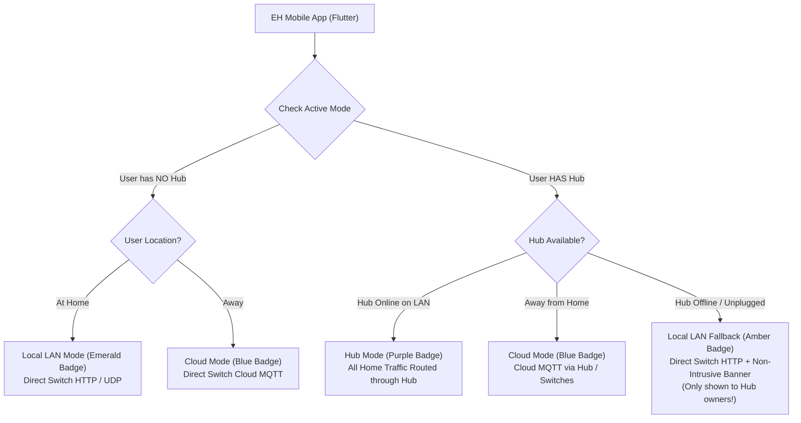

# EH Home — Master Dual-Ecosystem Architecture Specification
## Standalone Edge Devices, Optional Smart Hub Booster & Tri-State App Integration

**Document Version:** 2.0.0  
**Status:** Authoritative Architectural Master Specification  
**Classification:** Core Systems Engineering, Embedded Firmware, Mobile & Desktop Platform Architecture  
**Scope:** Standalone Non-Hub (Cases A, B, C) $\longleftrightarrow$ Hub-Boosted Ecosystem Parity, Desktop Production & Fleet Operations  

---

## 1. Executive Strategy: The Dual-Ecosystem Paradigm

The EH Home platform is founded upon an unshakeable architectural rule:

```
                           THE DUAL-ECOSYSTEM PARADIGM
 ┌─────────────────────────────────────────┐       ┌─────────────────────────────────────────┐
 │       STANDALONE NON-HUB ECOSYSTEM      │       │           HUB-BOOSTED ECOSYSTEM         │
 │     (100% Autonomous Edge Devices)      │       │     (On-Premise Local Private Cloud)    │
 ├─────────────────────────────────────────┤       ├─────────────────────────────────────────┤
 │ • Cap touch wall switches & relays      │       │ • Acts as Semi-Backend / Local Server   │
 │ • Direct Phone-to-Switch Local Wi-Fi    │       │ • Sub-5ms Multi-Device Mesh Engine      │
 │ • On-Chip NVS Flash Routines (RAM Exec) │       │ • 365-Day Energy Analytics (SQLite WAL) │
 │ • Fast-Path UDP P2P Cross-Device Rules  │       │ • Local 24/7 NTP Time Authority         │
 │ • BLE Fallback in Wi-Fi Dead Zones      │       │ • High-Speed LAN Firmware OTA Staging   │
 │ • Direct Cloud MQTT when away from home │       │ • Home Assistant & Matter Bridge        │
 └─────────────────────────────────────────┘       └─────────────────────────────────────────┘
                      ▲                                                 │
                      │                                                 │
                      └────── SILENT FAILOVER / UNPLUGGED RESILIENCE ───┘
                       (If Hub is unplugged, home seamlessly falls back
                        to Standalone Mode with zero broken switches)
```

### The Three Core Axioms:
1. **Axiom 1: The Hub is Strictly Optional & Secondary.**  
   Every smart switch, socket, and actuator is a self-contained computer. A consumer who never purchases a Hub receives a complete, enterprise-grade smart home that never bricks.
2. **Axiom 2: The Hub is an Accelerator, Never a Single Point of Failure.**  
   Adding a Hub enhances the home by removing microcontroller hardware constraints (flash wear, memory caps, RF dead zones). If the Hub is powered down, unplugged, or removed, **core standalone switch operations and critical life routines never stop functioning.**
3. **Axiom 3: Complete Protocol & Interface Parity.**  
   Both Standalone and Hub modes use the exact same REST endpoints (`/api/v1/control`, `/api/v1/routines`, `/api/v1/state`), UDP port 4210 beacons, and MQTT topic hierarchies (`eh/{deviceId}/cmd/power`, `eh/{deviceId}/evt/state`).

---

## 2. Non-Hub Device Flows (Cases A, B, C)

Every EH Smart Device must support all standalone features by default:

```
┌─────────────────────────────────────────────────────────────────────────────────────────────┐
│                           NON-HUB STANDALONE CAPABILITY SUITE                               │
├─────────────────────────────────────────────────────────────────────────────────────────────┤
│ 1. Dual Mode Operation: Local LAN (in-home) vs. Cloud MQTT (away-from-home).               │
│ 2. Single Routines: Committed directly to ESP32 on-chip NVS flash (up to 16 schedules).     │
│ 3. Group Routines: Mirrored to flash memory of all member devices in the group.             │
│ 4. First-Local Priority: Commands always prefer local Wi-Fi; Cloud is strictly a fallback.  │
│ 5. Time Sync: Cloud NTP when online; passive app injection (`X-Client-Epoch-Sec`) offline;  │
│    future hardware RTC timer expansion without breaking backup sync structures.             │
│ 6. Cross-Device P2P: Fast-Path UDP (<3ms) -> HTTP POST (100ms) -> Cloud MQTT fallback.    │
│ 7. Sensor Automations: On-chip threshold evaluation for local physical responses.           │
│ 8. Thread Support: ESP32-C6 native 802.15.4 mesh extension for out-of-reach devices.       │
└─────────────────────────────────────────────────────────────────────────────────────────────┘
```

---

### Case A: Single Floor with One Wi-Fi Router (Small Home / Apartment)

* **Physical Environment:** Single-level apartment or small home. One standard ISP Wi-Fi router.
* **Operating Mechanics:**
  1. **Local LAN Mode (Home):** When the user’s phone connects to the home Wi-Fi, the app discovers switches via UDP port 4210. Tapping a toggle dispatches `POST http://<switch_ip>/api/v1/control` directly. Response time: **5–12ms**. Even if the ISP fiber is cut, local control continues uninterrupted.
  2. **Cloud Mode (Away):** When the user leaves home (mobile 4G/5G), the app automatically switches to Cloud Mode, communicating with the switches via the secure Cloud MQTT broker.
  3. **Single & Group Routines:** Saved in each switch's on-chip NVS flash. Evaluated in RAM by `edge_routine_engine.c`.
  4. **Timekeeping:** Synced via NTP over internet. During internet outages, opening the mobile app on local Wi-Fi passively injects the phone's epoch time via the `X-Client-Epoch-Sec` HTTP header, instantly correcting switch clocks.
  5. **Cross-Device Automations (P2P Fast-Path):**
     - When Button 1 on Switch A is pressed, Switch A immediately transmits a 60-byte Unicast UDP datagram on port 4210 directly to Switch B's IP.
     - Switch B executes the relay and returns a 12-byte UDP ACK. Latency: **$<3\text{ms}$**.
     - If UDP drops, Switch A retries via HTTP POST. If local network fails, it falls back to Cloud MQTT.

---

### Case B: Multi-Floors with One Wi-Fi Router (Concrete Attenuation & ESP32-C6 Thread)

* **Physical Environment:** Multi-story building with a single router on the Ground floor. 1st and 2nd floors have weak Wi-Fi signal (`-82dBm` to `-89dBm`) or complete dead zones behind reinforced concrete slabs.
* **Operating Mechanics:**
  1. **Native ESP32-C6 802.15.4 / Thread Support:**  
     EH devices built with ESP32-C6 hardware feature native 2.4GHz IEEE 802.15.4 Thread mesh radios alongside Wi-Fi.
  2. **Out-of-Wi-Fi-Reach Bridging:**  
     A 2nd-floor device that cannot reach the ground-floor Wi-Fi router connects to a 1st-floor switch via Thread. The 1st-floor switch acts as a local Thread Router / Border Endpoint, relaying commands between the Wi-Fi network and the 2nd-floor Thread mesh.
  3. **Safe Connection Limits & Hub Recommendation:**  
     ESP32-C6 Thread routing is optimized for lightweight relaying (up to 8 child nodes). The mobile app monitors Thread child counts and link quality. If the mesh exceeds safe routing thresholds, the app issues a clean proactive advisory:
     > *"Your home has multiple floors and devices outside direct Wi-Fi range. We recommend adding an EH Hub to provide dedicated high-power mesh routing and eliminate latency."*
  4. **Direct BLE Rescue Fallback:**  
     If a device is completely isolated, walking into the room with a smartphone enables **Direct Bluetooth Low Energy (BLE)** control within 10 meters. Physical capacitive touch wall buttons always operate relays in **0ms** regardless of RF connectivity.

---

### Case C: Multi-Floors with Multiple Wi-Fi Routers / Extenders (Same Fiber)

* **Physical Environment:** Multi-story building with main router on Ground Floor and Wi-Fi extenders/routers on 1st and 2nd floors under the same ISP connection.
* **Operating Mechanics:**
  1. **Direct Unicast Reverse Registration:**  
     Devices connect to the nearest floor's Wi-Fi extender. Because cheap extenders drop UDP broadcast packets (`255.255.255.255`), devices use **Direct Unicast IP messaging** (`POST http://<peer_ip>/api/v1/control`) which extenders never drop.
  2. **Cross-Floor Local P2P:**  
     Ground Floor 2X Switch sends local P2P commands through the main router and 1st-floor extender directly to the 1st Floor 3X Switch. Staircase light toggles in **$<10\text{ms}$ locally**, without internet or hub dependency.

---

## 3. With-Hub Ecosystem Flows: The On-Premise Master Brain

When a customer purchases an **EH Smart Home Hub**, all three deployment topologies (Cases A, B, and C) are elevated into an enterprise-grade private cloud:



### 1. Hub Takeover & Tri-State App Engine
* **Before Hub Setup:** App operates in dual mode: `Local LAN` (in-home) $\longleftrightarrow$ `Cloud` (away).
* **After Hub Setup:** App transitions to **Hub-Centric Tri-State Engine**:
  - **Hub Mode (`HUB`):** When at home, all control, state queries, and routine modifications route exclusively through the Hub. Latency is $<5\text{ms}$. The dashboard displays the high-contrast **Hub Mode** badge.
  - **Cloud Mode (`CLOUD`):** When away from home, commands route through the Cloud to the Hub or devices.
  - **Local LAN Fallback (`FALLBACK`):** If the Hub loses power or is unplugged, the app detects Hub unreachability within 3 seconds and **silently falls back to direct switch Local LAN control**. A discreet banner appears:
    > *"Hub is unreachable. Operating via direct Local LAN. All switches remain functional."*
    *(This banner is strictly scoped to users who have a Hub configured—non-hub users never see it!)*

### 2. Hub as a Semi-Backend / Local Private Cloud
* **100% RAM Scheduler with SQLite WAL Durability:** All household comfort routines run in Hub RAM with zero switch flash wear. Power cuts cannot corrupt state.
* **Local 24/7 NTP Time Authority:** Hub runs an embedded NTP server (UDP port 123) and broadcasts epoch beacons. Clocks never drift, even during multi-week ISP outages.
* **365-Day Energy Analytics:** Ingests 10-second power samples from smart sockets/switches and computes hourly, daily, and monthly kWh rollups locally in SQLite.
* **High-Speed LAN Firmware OTA Distribution:** Hub caches verified `.bin` images from GitHub Releases/Cloud and serves high-speed HTTP OTA updates to switches over local Wi-Fi in ~5 seconds.
* **Third-Party Bridge (Home Assistant / Matter):** Hub exposes a local REST API and local MQTT broker (port 1883) for Home Assistant and local Matter/Apple HomeKit integration.

---

## 4. Desktop Engineering & Production App Architecture (`apps/desktop`)

The desktop application (`apps/desktop`, powered by Tauri v2 + React + TypeScript) is the authoritative workstation for engineering, factory provisioning, hardware validation, and Hub ecosystem fleet management.

```
┌─────────────────────────────────────────────────────────────────────────────────────────────┐
│                            DESKTOP WORKBENCH ARCHITECTURE                                   │
├──────────────────────────────┬──────────────────────────────┬───────────────────────────────┤
│ 1. Factory Bench Provisioner │ 2. Dynamic Hub Fleet Monitor │ 3. Production Inventory & OTA │
├──────────────────────────────┼──────────────────────────────┼───────────────────────────────┤
│ • Native Python sidecar      │ • Dynamic subnet scan for    │ • Firmware binary digest      │
│   flasher with 8 security    │   Hub (replaces hardcoded    │   validation (SHA-256).       │
│   validation gates.          │   192.168.0.174).            │ • Packaging & label printing  │
│ • Flashes ESP32, ESP32-C6,   │ • Live Hub diagnostics, CPU, │   (TSPL & Windows PDF).       │
│   and Raspberry Pi Hub image │   RAM, and SQLite metrics.   │ • Production traceability     │
│ • Generates Factory Identity │ • Adopted devices inventory  │   records without secret      │
│   v2 cryptographic secrets.  │   and real-time LAN states.  │   leakage.                    │
└──────────────────────────────┴──────────────────────────────┴───────────────────────────────┘
```

### Upgrades Required in Desktop App:
1. **Dynamic Hub Network Resolution:**  
   Replace hardcoded `http://192.168.0.174:4210` in [`DashboardView.tsx`](file:///c:/Users/pavan/Downloads/Flutter/SMART_HOME_V1/apps/desktop/src/features/dashboard/DashboardView.tsx#L81) with dynamic subnet scanning (`/api/v1/hub/info` across active network interfaces or mDNS `eh-hub.local`).
2. **Hub Production Flashing Target:**  
   Add Raspberry Pi 3B+ / SBC SD card image flashing and provisioning into the `ProvisionerView` so assembly bench technicians can flash and provision Hubs with the same rigor as ESP32 smart switches.
3. **Ecosystem Telemetry Bridge:**  
   Allow the desktop app to query the Hub's SQLite WAL database directly over LAN to view live fleet diagnostics, signal quality (RSSI), and crash logs.

---

## 5. Comprehensive Ecosystem Master Matrix

| Capability Dimension | Standalone Non-Hub Home | Hub-Boosted Smart Home |
| :--- | :--- | :--- |
| **Physical Wall Switch Response** | Instant ($0\text{ms}$) via Hardware GPIO | Instant ($0\text{ms}$) via Hardware GPIO |
| **In-Home Phone App Latency** | $10\text{--}15\text{ms}$ (direct switch IP) | $<5\text{ms}$ (via Hub LAN proxy) |
| **App Network Mode Badge** | `Local LAN` $\longleftrightarrow$ `Cloud` | `Hub Mode` $\longleftrightarrow$ `Cloud` (Fallback to `LAN`) |
| **Single-Device Routines** | Stored in on-chip ESP32 NVS flash | Stored in Hub DB (Critical dual-synced to NVS) |
| **Cross-Device Automations** | **Fast-Path UDP ($<3\text{ms}$)** + Cloud fallback | **Central Hub Engine ($<2\text{ms}$)** 100% offline |
| **ISP Fiber Cut Behavior** | Local app & P2P rules continue working | Local app & all multi-room rules continue working |
| **Clock Sync during Long Outages** | Passive phone app sync (`X-Client-Epoch-Sec`) | **Local NTP Server on Hub (UDP 123)** |
| **Energy Consumption History** | Real-time live wattage; Cloud history | **365-day hourly rollups in Hub SQLite WAL** |
| **Multi-Floor RF Dead Zones** | Direct BLE (10m) + ESP32-C6 Thread Mesh | Hub coordinates Thread & Wi-Fi mesh routing |
| **Firmware Update Distribution** | Direct download from Cloud / GitHub | **Hub caches .bin images; LAN flash in ~5s** |
| **Third-Party Integration** | Cloud REST API | **Local Home Assistant API & Matter Bridge** |
| **Switch Flash Wear** | Normal NVS wear-leveling ($27+\text{ years}$) | **Zero flash wear** (routines run in Hub RAM) |

---

## 6. Implementation Action Plan

1. **Step 1 (Flutter App Dynamic Mode & Real Hub Telemetry):**
   - Implement dynamic Hub mDNS/subnet discovery in `LiveHubRepository` (eliminating hardcoded `192.168.0.174`).
   - Implement the Tri-State mode engine in `HomeController` (`Hub Mode`, `Local LAN`, `Cloud`, and `Hub Fallback` banner for hub owners).
   - Replace all placeholder/mock strings in `hub_management_page.dart` with real dynamic data from the SQLite WAL Hub engine.
2. **Step 2 (Firmware Fast-Path P2P UDP & NVS Power-On Behavior):**
   - Add Unicast UDP action dispatch on port 4210 in `local_server.c` for $<3\text{ms}$ direct switch-to-switch toggling.
   - Add configurable power-on behavior in `relay_manager.c` (`ALWAYS_OFF`, `ALWAYS_ON`, `RESTORE_LAST`).
3. **Step 3 (Desktop App Network Modernization):**
   - Update `DashboardView.tsx` to discover Hub dynamically across local subnets instead of using static IP `192.168.0.174`.
   - Add Hub provisioning profile to the bench flasher tools.
