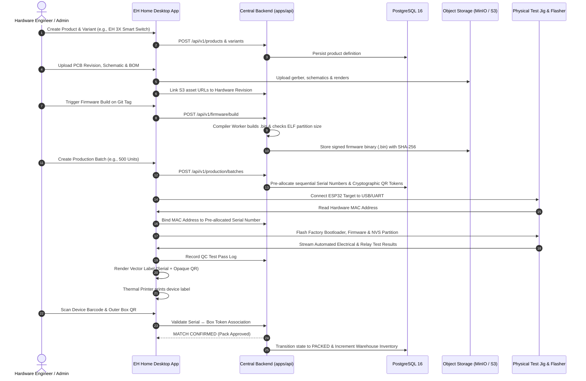
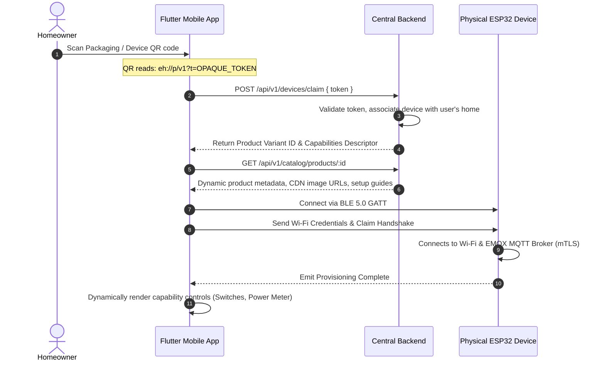

# EH Home — Data Flow & Lifecycle Invariants

**Status:** APPROVED (Part 00 Baseline)  

---

## 1. End-to-End Product Creation to Manufacturing Flow

---

## 2. Customer Pairing & In-App Dynamic Rendering Flow

