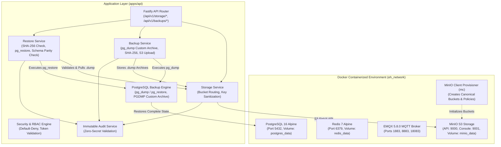
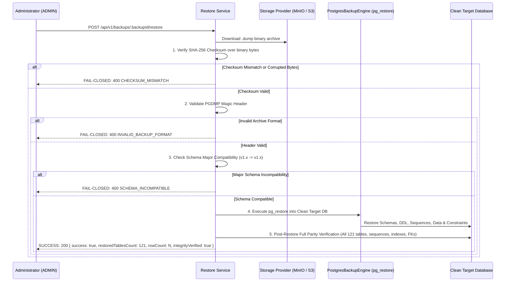

# EH Home Platform Architecture — Part 16: Docker, MinIO, S3-Compatible Storage, PostgreSQL-Native Backup & Disaster Recovery

## 1. Executive Summary

Part 16 implements containerized local infrastructure, an S3-compatible object storage abstraction, native PostgreSQL logical database backup (`pg_dump` in Custom Archive `-Fc` format) with SHA-256 cryptographic binary integrity verification, PostgreSQL-native restore procedures (`pg_restore`), complete database scope preservation (schemas, sequences, indexes, constraints, foreign keys, types, enums, and all domain tables), configurable retention policies, disaster recovery validation, and zero-secret RBAC/audit integration.

The architecture decouples business logic from vendor-specific storage APIs through a unified provider interface (`IStorageProvider`), supporting:
- **MinIO** in containerized local and CI environments.
- **Amazon S3** or compliant S3 endpoints in production.
- **In-Memory Storage** (`MemoryStorageProvider`) for isolated unit tests, ephemeral validation, and offline development.

---

## 2. Infrastructure Topology



---

## 3. Storage Abstraction Architecture

### 3.1 Provider Interface (`IStorageProvider`)

All application components consume object storage exclusively through `IStorageProvider`. Direct SDK imports are forbidden outside provider implementations.

```typescript
export interface IStorageProvider {
  init(): Promise<void>;
  putObject(bucket: StorageBucket, key: string, content: Buffer | Uint8Array | string, options?: PutObjectOptions): Promise<StorageObjectMetadata>;
  getObject(bucket: StorageBucket, key: string): Promise<{ content: Buffer; metadata: StorageObjectMetadata }>;
  headObject(bucket: StorageBucket, key: string): Promise<StorageObjectMetadata>;
  deleteObject(bucket: StorageBucket, key: string): Promise<boolean>;
  listObjects(bucket: StorageBucket, prefix?: string, limit?: number, continuationToken?: string): Promise<ListObjectsResult>;
  getSignedUrl(bucket: StorageBucket, key: string, expiresInSeconds?: number, action?: 'GET' | 'PUT'): Promise<SignedUrlResult>;
  hasObject(bucket: StorageBucket, key: string): Promise<boolean>;
  isHealthy(): Promise<StorageHealthResult>;
}
```

### 3.2 Implemented Providers

| Provider | Purpose | Characteristics |
| :--- | :--- | :--- |
| `S3StorageProvider` | MinIO & AWS S3 Production | Native AWS SigV4 authorization, HMAC-SHA256 signature calculation, presigned GET/PUT URLs, XML response parsing with zero third-party runtime dependencies. |
| `MemoryStorageProvider` | Unit Testing & Offline Dev | Pure in-memory bucket isolation, true SHA-256 hashing, prefix filtering, and zero external network prerequisites. |

---

## 4. Canonical Buckets & Object-Key Policy

To prevent namespace collisions, guarantee collision safety, and prevent path traversal vulnerabilities, all keys are generated and sanitized via `CanonicalObjectKeyBuilder`.

### 4.1 Canonical Buckets & Access Policies

```text
eh-product-assets        → Public/consumer-safe product marketing imagery and design assets (Anonymous GET allowed)
eh-firmware-artifacts    → Private release-gated firmware binaries and signatures (Requires firmware:release / storage:read)
eh-manufacturing-labels  → Private factory QR tokens and packaging PDF labels (Requires manufacturing:provision / storage:read)
eh-database-backups      → Private PostgreSQL .dump Custom Archives and manifests (Requires backup:read / backup:restore)
```

### 4.2 Deterministic Key Schemes

| Data Class | Canonical Path Format | Example |
| :--- | :--- | :--- |
| **Product Asset** | `products/{productId}/variants/{variantId}/images/{assetId}_{filename}` | `products/prod-001/variants/var-01/images/ast-99_front.png` |
| **Firmware Binary** | `firmware/{family}/{version}/{targetMcu}/{sha256}.bin` | `firmware/esp32c6-switch/1.2.0/esp32-c6/a1b2c3d4e5f6...bin` |
| **Manufacturing Label** | `labels/{deviceId}/{qrToken}.pdf` | `labels/0194fe23-7a1b/ehqr_sec_7a1b890c2345.pdf` |
| **Database Backup** | `backups/{isoTimestamp}_v{schemaVersion}_{identifier}.dump` | `backups/2026-09-27T10-00-00-000Z_v1.0.0_e3b0c442_bk_01.dump` |

### 4.3 Key Sanitization & Path Traversal Prevention

The `CanonicalObjectKeyBuilder` strictly rejects or strips `..`, leading/trailing slashes, and control characters:
- `../../../etc/passwd` $\to$ `etc/passwd`
- `//products//images//` $\to$ `products/images`

---

## 5. Security, RBAC & Audit Integration

### 5.1 Role-to-Permission Matrix

Storage and Backup actions require explicit platform permissions:

| Permission | ADMIN | RELEASE_ENGINEER | OPERATOR | AUDITOR | SERVICE | USER |
| :--- | :---: | :---: | :---: | :---: | :---: | :---: |
| `storage:read` | **YES** | **YES** | **YES** | **YES** | **YES** | NO |
| `storage:write` | **YES** | **YES** | **YES** | NO | **YES** | NO |
| `storage:delete` | **YES** | NO | NO | NO | NO | NO |
| `backup:create` | **YES** | NO | NO | NO | **YES** | NO |
| `backup:read` | **YES** | NO | NO | **YES** | **YES** | NO |
| `backup:restore` | **YES** | NO | NO | NO | NO | NO |
| `backup:delete` | **YES** | NO | NO | NO | NO | NO |

### 5.2 Zero-Secret Invariant & Audit Logging

Sensitive operations emit structured audit logs verified against zero-secret invariants:
- `OBJECT_STORED`
- `OBJECT_DELETED`
- `BACKUP_CREATED`
- `BACKUP_RESTORED`
- `BACKUP_RESTORE_FAILED`
- `BACKUP_PRUNED`

---

## 6. PostgreSQL-Native Backup, Complete Database Scope & Recovery

### 6.1 Native PostgreSQL Logical Backup Architecture

The canonical database backup mechanism uses the PostgreSQL Custom Archive format (`-Fc`):

* **Exact Backup Command**: `pg_dump -Fc --no-owner --no-privileges -d <database>`
* **Exact Restore Command**: `pg_restore --clean --if-exists --no-owner --no-privileges -d <target_database>`
* **Format**: `POSTGRES_CUSTOM_ARCHIVE` with PostgreSQL magic header `PGDMP` (`0x50 0x47 0x44 0x4D 0x50`, version 1.4.0, format 3).
* **Cryptographic Integrity**: SHA-256 checksum calculated directly over the complete binary `.dump` archive file.
* **Complete Database Scope (Migrations 001–035)**:
  1. **Schemas (2)**: `public`, `eh_home`.
  2. **Authoritative Managed Tables (121 Tables across all domains)**:
     - Catalog & Hardware (Part 1–4, 30): `products`, `product_variants`, `product_models`, `product_families`, `product_capabilities`, `product_images`, `hardware_revisions`, `bom_specifications`, `bom_items`, `component_substitutions`, `product_variant_hardware_compatibility`.
     - Firmware & OTA (Part 8, 11, 13, 28, 31): `firmware_families`, `firmware_releases`, `firmware_builds`, `firmware_artifacts`, `firmware_hardware_compatibility`, `ota_rollouts`, `ota_operations`, `ota_attempts`, `ota_execution_jobs`, `fleet_device_firmware_state`.
     - Devices, Identity & Transports (Part 1, 6, 7, 19, 25, 26, 32): `devices`, `device_credentials`, `device_credential_lifecycle`, `device_authorizations`, `device_state`, `channel_state`, `device_commands`, `device_events`, `device_transports`, `device_connection_states`, `device_trust_states`, `device_revocations`, `network_identity`.
     - Health, Observability & Reliability (Part 7, 11, 18, 24, 25, 29, 31, 34): `device_activity_logs`, `device_health_metrics`, `device_maintenance_logs`, `device_availability_history`, `maintenance_recommendations`, `reliability_incidents`, `reliability_diagnostics`, `reliability_recovery_attempts`, `reliability_health_snapshots`, `system_health_snapshots`, `transport_health_snapshots`, `platform_incidents`, `platform_alerts`, `platform_events`, `operational_events`.
     - Factory, Provisioning & Inventory (Part 5, 8, 33): `provisioning_sessions`, `commissioning_sessions`, `device_provisioning_records`, `device_add_sessions`, `dual_scan_verifications`, `packaging_records`, `packaging_cartons`, `inventory_items`.
     - Energy Intelligence & Tariffs (Part 12, 14, 19, 20, 21, 22): `energy_tariffs`, `tariff_periods`, `energy_budgets`, `energy_baselines`, `energy_efficiency_scores`, `energy_forecasts`, `energy_optimizations`, `cost_optimizations`, `energy_threshold_configs`, `energy_anomalies`, `energy_events`, `energy_automation_executions`, `forecast_accuracy_records`, `device_telemetry_measurements`, `telemetry_aggregates`.
     - Automations, Context & Scenes (Part 6, 16, 17, 23, 24): `automations`, `scenes`, `schedules`, `automation_execution_logs`, `presence_signals`, `presence_states`, `home_contexts`, `context_transitions`, `context_overrides`, `intelligence_decisions`, `intelligence_recommendations`, `intelligence_decision_outcomes`.
     - Home Topology & Memberships (Part 1, 9, 16): `homes`, `rooms`, `floors`, `home_memberships`, `home_invitations`.
     - Matter Ecosystem (Part 22, 29): `matter_devices`, `matter_endpoints`, `matter_fabrics`, `matter_sync_state`.
     - Edge & Local Execution (Part 21, 28): `edge_execution_records`, `local_discovery_nodes`, `local_route_cache`.
     - Notifications & Alerts (Part 8, 23, 30): `notifications`, `notification_delivery_queue`, `notification_actions`, `notification_aggregations`, `user_notification_preferences`, `push_device_tokens`.
     - Sync, Outbox & Disaster Recovery (Part 2, 10, 17, 26, 33): `outbox`, `sync_checkpoints`, `pending_change_audits`, `data_export_records`, `backup_records`, `backup_objects`, `restore_operations`, `recovery_checkpoints`, `recovery_integrity_results`.
     - Part 13 — MQTT Telemetry & OTA: `mqtt_acl_rules`, `device_availability_history`, `ota_execution_jobs`.
     - Part 14 — Security, RBAC & Audit: `user_security_principals`, `security_audit_events`, `users`, `user_profiles`, `refresh_tokens`, `external_platform_links`, `capabilities`, `audit_logs`, `security_audit_records`.
  3. **Sequences (10)**: `audit_logs_seq`, `devices_seq`, `orders_seq`, `notifications_seq`, `energy_events_seq`, `ota_jobs_seq`, `provisioning_sessions_seq`, `telemetry_seq`, `packaging_seq`, `backup_records_seq`.
  4. **Enums & Custom Types (12)**: `user_role_enum`, `principal_status_enum`, `device_status_enum`, `firmware_lifecycle_enum`, `ota_job_state_enum`, `qc_result_enum`, `packaging_status_enum`, `inventory_status_enum`, `home_role_enum`, `energy_tariff_type_enum`, `matter_transport_enum`, `trust_state_enum`.
  5. **Indexes & Constraints (178 Indexes)**: Primary keys on all 121 tables, foreign key relational integrity, unique constraints, and B-Tree indexes.

### 6.2 Backup Manifest (`BackupManifest`)

Each `.dump` backup is paired with an immutable `BackupManifest` containing:
- `backupId`: Unique canonical backup identifier.
- `timestamp`: UTC ISO datetime.
- `schemaVersion`: Current Drizzle/migration schema version (`1.0.0`).
- `migrationVersion`: Current authoritative migration baseline (`035_security_rbac_audit`).
- `pgVersion`: Target PostgreSQL engine version (`16.0`).
- `backupTool`: `'pg_dump'`.
- `commandArgs`: `['-Fc', '--no-owner', '--no-privileges', '-d eh_home_master']`.
- `format`: `'POSTGRES_CUSTOM_ARCHIVE'`.
- `sha256`: Hexadecimal SHA-256 digest of archive bytes.
- `sizeBytes`: Binary byte size.
- `tableCount`: Count of tables in archive (`121`).
- `rowCount`: Total row count across all 121 tables.
- `checksumVerified`: `true`.
- `tablesIncluded`: Array of all 121 managed table names.

### 6.3 Restore & Recovery Procedure



### 6.4 Backup Retention Policy & Namespace Safety

Configurable via `BackupRetentionPolicy` (`maxBackupsCount: 30`, `retentionDays: 30`). Pruning sorts backup sets by timestamp descending, deletes `.dump` and `.manifest.json` objects exceeding limits, strictly asserts the `eh-database-backups` namespace and `backups/` prefix, and logs `BACKUP_PRUNED` audit events. Pruning never touches firmware, product assets, or manufacturing labels.

---

## 7. Health & Readiness Integration

The API `/ready` endpoint probes both database and storage dependencies:
- Returns `200 READY` when database and storage provider are operational.
- Returns `503 DOWN` if PostgreSQL or MinIO connection fails.

---

## 8. Verification & Test Coverage

| Test Suite | Purpose | Status | Tests |
| :--- | :--- | :---: | :---: |
| `packages/contracts/tests/storage-contract.test.js` | Bucket schemas, key builders, manifest validation, RBAC | **PASSED** | 6/6 |
| `apps/api/tests/storage-provider.test.js` | Put/Get/Head/Delete/List/Signed URL, SigV4, Path Traversal, Bucket Policies | **PASSED** | 8/8 |
| `apps/api/tests/backup-restore-recovery.test.js` | Complete 121-table PostgreSQL Custom Archive (.dump), pg_dump/pg_restore, SHA-256 byte check, clean restore, full 121-table parity, Part 13 & Part 14 domain verification, corruption/tamper rejection, missing table failure, schema version check, retention pruning | **PASSED** | 10/10 |
| `apps/api/tests/storage-backup-routes.test.js` | HTTP routes, Fastify injection, RBAC enforcement, /ready | **PASSED** | 1/1 |
| Monorepo Validation (`scripts/validate-repo.js`) | Monorepo full regression suite | **PASSED** | 76 pass / 0 fail / 1 skipped |

---

## 9. Known Limitations

1. **Cloud Multi-Region Replication:** Cross-region replication is handled at the S3/MinIO infrastructure level and not orchestrated by application code.
2. **Streaming Multipart Uploads:** Payloads up to 10MB are handled via single-part buffer transfer. Multipart streaming for multi-gigabyte files will be evaluated in future operational phases.

