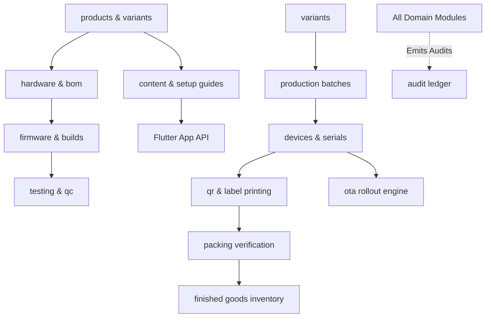

# EH Home — Module Boundaries (Modular Monolith)

**Status:** APPROVED (Part 00 Baseline)  
**Location:** `apps/api/src/modules/`  

---

## 1. Architectural Philosophy

The central backend is implemented as a **Modular Monolith**. It avoids premature microservice overhead while enforcing strict encapsulation between domain boundaries. Each module owns its:
1. `routes.ts`: HTTP and WebSocket route definitions validated strictly via Zod.
2. `service.ts`: Business logic and transaction boundaries.
3. `repository.ts`: Drizzle ORM queries and relational projections.
4. `events.ts`: Internal domain events emitted to BullMQ and the realtime bus.

No module may directly query another module's internal database tables without going through that module's public service contract or shared Drizzle relations.

---

## 2. Core Domain Modules

```text
apps/api/src/modules/
├── auth/           # Identity, JWT lifecycle, RBAC, Operator sessions
├── products/       # Master catalog, product categories, capability metadata
├── variants/       # Commercial SKUs, electrical specs, packaging profiles
├── hardware/       # PCB revisions, schematics, pin maps, gerber metadata
├── bom/            # Bill of Materials, component MPNs, vendor pricing
├── firmware/       # Firmware projects, git commit linkages, binary digests
├── builds/         # Headless compiler orchestration, ELF validation, size bounds
├── testing/        # Automated test jig protocols, bench RSSI and power thresholds
├── devices/        # Physical device records, unique UUID, MAC, serial allocation
├── production/     # Batch planning, staging states, operator work orders
├── qr/             # Cryptographic opaque QR generation, batch exports, verification
├── packing/        # Dual-scan device-to-box verification, tamper seal audits
├── inventory/      # Raw components, finished goods, warehouse bin tracking
├── content/        # Setup guides, troubleshooting, FAQs, media asset CDN
├── ota/            # Firmware compatibility matrix, staged rollout rings, health checks
└── audit/          # Append-only immutable change ledger
```

---

## 3. Module Interaction Boundaries


