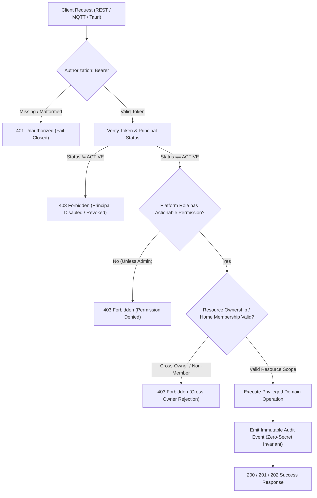

# EH HOME ARCHITECTURE — PART 14: RBAC, SECURITY & IMMUTABLE AUDIT

**Version**: 1.0.0  
**Status**: Authoritative / Approved  
**Domain**: Identity, Access Management, Resource Ownership & Compliance Logging  

---

## 1. Executive Summary

Part 14 establishes the **Canonical Role-Based Access Control (RBAC), Security Enforcement, Resource Authorization, and Immutable Audit Logging** architecture for the EH Home Platform. It unifies backend authorization across `apps/api`, shared contracts (`@eh-home/contracts`), PostgreSQL schema (`@eh-home/db-schema`), manufacturing/desktop boundaries, and consumer home ownership.

Every privileged operation across firmware releases, signed OTA, bench provisioning, dual-scan packing, inventory management, and device ownership enforces **fail-closed, default-deny server-side authorization** with an append-only audit trail guaranteeing zero secret leakage.

---

## 2. Security Objectives & Verification Flow

The EH Home authorization pipeline strictly separates **Authentication** (*Who is the principal?*) from **Authorization** (*Is the principal permitted to execute this operation on this specific resource?*):

```text
Authenticated Principal
        ↓
Identity Verification (Status: ACTIVE / DISABLED / REVOKED)
        ↓
Platform Role & Actionable Permission Check
        ↓
Resource-Level Authorization (Home Membership / Device Ownership)
        ↓
Privileged Operation Execution
        ↓
Immutable Append-Only Audit Event
```



---

## 3. Canonical Roles & Permission System

### 3.1 Platform User Roles (`UserRole`)
Defined canonically in [packages/contracts/src/security/index.ts](file:///c:/Users/pavan/Downloads/Flutter/SMART_HOME_V1/packages/contracts/src/security/index.ts):

| Platform Role | Description | Core Responsibilities |
| :--- | :--- | :--- |
| `ADMIN` | Platform & Security Administrator | Full system authority, user/role management, security policy admin, universal fallback |
| `RELEASE_ENGINEER` | Firmware & Binary Release Engineer | Build validation, artifact registration, release approval, publication, OTA rollout |
| `OPERATOR` | Factory & Manufacturing Operator | Bench provisioning, QC testing, dual-scan packing, carton verification, inventory |
| `AUDITOR` | Compliance & Security Inspector | Read-only access to audit logs, product catalog, firmware manifests, device registry |
| `USER` | Standard Consumer User | Home ownership, room/device management, device control within assigned homes |
| `SERVICE` | System Background Daemon | Automated telemetry processing, availability derivation, scheduled cron tasks |

### 3.2 Home Membership Roles (`HomeRole`)
Defined canonically in [packages/contracts/src/security/index.ts](file:///c:/Users/pavan/Downloads/Flutter/SMART_HOME_V1/packages/contracts/src/security/index.ts):

| Home Role | Description | Permissions |
| :--- | :--- | :--- |
| `OWNER` | Home Creator & Authority | Full home control, delete home, transfer ownership, manage members, control/claim devices |
| `HOME_ADMIN` | Home Administrator | Manage devices, manage home members, manage automations, control devices |
| `MEMBER` | Standard Family Member | Control devices, view home state, trigger automations |
| `GUEST` | Temporary Guest | Restricted device control, view state |
| `VIEWER` | Read-Only Viewer | View home status, **no** device control or mutation authority |

*Note: Platform `ADMIN` is a platform-wide system role and is distinct from Home `HOME_ADMIN` which is strictly scoped to an individual home boundary.*

### 3.3 System `SERVICE` Role & Least-Privilege Scoping
The `SERVICE` principal represents internal background daemons, scheduled cron workers, and automated synchronization tasks:
- **Explicitly Allowed**: `product:read`, `hardware:read`, `firmware:read`, `ota:read`, `ota:execute`, `device:read`, `device:write`, `device:control`, `manufacturing:inventory`, `audit:read`.
- **Explicitly Denied**: User/role administration (`user:*`, `role:*`, `security:admin`), firmware approval/release/revocation (`firmware:approve`, `firmware:release`, `firmware:revoke`), OTA authorization (`ota:authorize`), factory provisioning/QC/packing (`manufacturing:provision`, `manufacturing:qc`, `manufacturing:pack`, `manufacturing:print`), device claiming/unclaiming/transfer (`device:claim`, `device:unclaim`, `device:transfer`, `device:revoke`), and home management (`home:write`, `home:delete`, `home:manage_members`).
- **Resource Scope**: Strictly bounded to automated system tasks; `SERVICE` cannot perform user-facing ownership claims or bypass cross-owner restrictions.

---

## 4. Canonical Role-to-Permission Matrix

```text
Permission Matrix:
                               ADMIN   REL_ENG   OPERATOR   AUDITOR   USER   SERVICE
product:read                     ●        ●         ●          ●       ●        ●
product:write                    ●        ○         ○          ○       ○        ○
hardware:read                    ●        ●         ●          ●       ○        ●
hardware:write                   ●        ○         ○          ○       ○        ○
firmware:read                    ●        ●         ●          ●       ○        ●
firmware:write                   ●        ●         ○          ○       ○        ○
firmware:approve                 ●        ●         ○          ○       ○        ○
firmware:release                 ●        ●         ○          ○       ○        ○
firmware:revoke                  ●        ●         ○          ○       ○        ○
ota:read                         ●        ●         ●          ●       ○        ●
ota:authorize                    ●        ●         ○          ○       ○        ○
ota:execute                      ●        ●         ○          ○       ○        ●
manufacturing:provision          ●        ○         ●          ○       ○        ○
manufacturing:qc                 ●        ○         ●          ○       ○        ○
manufacturing:pack               ●        ○         ●          ○       ○        ○
manufacturing:inventory          ●        ○         ●          ○       ○        ●
manufacturing:print              ●        ○         ●          ○       ○        ○
device:read                      ●        ●         ●          ●       ●        ●
device:write                     ●        ○         ○          ○       ○        ●
device:control                   ●        ○         ○          ○       ●        ●
device:claim                     ●        ○         ●          ○       ●        ○
device:unclaim                   ●        ○         ○          ○       ●        ○
device:transfer                  ●        ○         ○          ○       ○        ○
device:revoke                    ●        ○         ○          ○       ○        ○
device:quarantine                ●        ○         ○          ○       ○        ○
home:read                        ●        ○         ○          ●       ●        ○
home:write                       ●        ○         ○          ○       ●        ○
home:delete                      ●        ○         ○          ○       ○        ○
home:manage_members              ●        ○         ○          ○       ●        ○
user:read                        ●        ○         ○          ●       ○        ○
user:write                       ●        ○         ○          ○       ○        ○
user:manage_roles                ●        ○         ○          ○       ○        ○
audit:read                       ●        ●         ○          ●       ○        ●
security:admin                   ●        ○         ○          ○       ○        ○
```
*(● = Authorized, ○ = Denied)*

---

## 5. Resource-Level Authorization & Ownership Protections

1. **Device Claiming**:
   - Only unclaimed devices in `FACTORY` or `PROVISIONED` state can be claimed.
   - Attempting to claim an already-claimed device is rejected with conflict error.
2. **Cross-Owner Protection**:
   - Unclaiming, transferring, or deleting a device requires caller identity to match `claimedByUserId` (or caller must be platform `ADMIN`).
   - Unauthorized callers are rejected with `403 CROSS_OWNER_DENIED` and an audit security event is logged.
3. **Home-Level Scoping**:
   - Controlling a device requires active membership in the home to which the device is bound.
   - Non-members attempting device control receive `403 Forbidden`.
   - `VIEWER` home members are strictly denied `device:control`.
4. **Audit Atomicity & Transactional Integrity**:
   - Privileged operations and audit logging are coupled: when a privileged operation executes, the audit record is validated and logged synchronously.
   - If audit persistence fails (e.g., zero-secret violation), the privileged operation fails closed (throws error), preventing un-audited state changes.

---

## 6. Privileged Manufacturing & Operations Boundary

| Operation | Protected Route | Required Permission | Authorized Roles |
| :--- | :--- | :--- | :--- |
| **Firmware Release Creation** | `POST /api/v1/firmware/releases` | `firmware:write` | `ADMIN`, `RELEASE_ENGINEER` |
| **Firmware Release Approval** | `POST /api/v1/firmware/releases/:id/approve` | `firmware:approve` | `ADMIN`, `RELEASE_ENGINEER` |
| **Firmware Publication** | `POST /api/v1/firmware/releases/:id/publish` | `firmware:release` | `ADMIN`, `RELEASE_ENGINEER` |
| **Firmware Revocation** | `POST /api/v1/firmware/releases/:id/revoke` | `firmware:revoke` | `ADMIN`, `RELEASE_ENGINEER` |
| **OTA Job Authorization** | `POST /api/v1/ota/jobs/:id/authorize` | `ota:authorize` | `ADMIN`, `RELEASE_ENGINEER` |
| **Carton Packing Completion** | `POST /api/v1/inventory/packaging/complete` | `manufacturing:pack` | `ADMIN`, `OPERATOR` |
| **Dual-Scan Verification** | `POST /api/v1/inventory/dual-scan` | `manufacturing:pack` | `ADMIN`, `OPERATOR` |
| **Device Revocation** | `POST /api/v1/security/devices/:id/revoke` | `device:revoke` | `ADMIN` |
| **User Role Management** | `PATCH /api/v1/security/users/:id/role` | `user:manage_roles` | `ADMIN` |
| **User Status Admin** | `PATCH /api/v1/security/users/:id/status` | `security:admin` | `ADMIN` |

---

## 7. Immutable Audit Trail & Zero-Secret Policy

### 7.1 Immutability Guarantees
- Audit records in table `security_audit_events` (Migration 035) and `security_audit_records` (Migration 024) are **append-only**.
- No `UPDATE` or `DELETE` endpoints or repository methods exist for audit logs.
- Audit records include monotonic sequence numbers, ISO-8601 timestamps, actor IDs, roles, actions, resource types, outcomes, and correlation IDs.

### 7.2 Zero-Secret Invariant
- Every audit record passes through `assertNoSecretsInAuditPayload()` before database write.
- Rejects any payload containing:
  - `password`, `password_hash`, `passwordhash`
  - `token`, `access_token`, `refresh_token`
  - `private_key`, `privkey`, `PEM headers (BEGIN PRIVATE KEY)`
  - `wifi_password`, `session_key`, `device_secret`, `signing_key`
  - `api_key`, `auth_key`

---

## 8. Database Schema (Migration 035)

```sql
-- User Security Principals
CREATE TABLE IF NOT EXISTS user_security_principals (
    id VARCHAR(128) PRIMARY KEY,
    email VARCHAR(255) UNIQUE NOT NULL,
    role VARCHAR(32) NOT NULL DEFAULT 'USER' CHECK (role IN ('ADMIN', 'OPERATOR', 'RELEASE_ENGINEER', 'AUDITOR', 'USER', 'SERVICE')),
    status VARCHAR(32) NOT NULL DEFAULT 'ACTIVE' CHECK (status IN ('ACTIVE', 'DISABLED', 'REVOKED', 'PENDING_ACTIVATION')),
    mfa_enabled BOOLEAN NOT NULL DEFAULT FALSE,
    failed_login_attempts INTEGER NOT NULL DEFAULT 0,
    last_login_at TIMESTAMPTZ,
    last_password_change_at TIMESTAMPTZ,
    created_at TIMESTAMPTZ NOT NULL DEFAULT NOW(),
    updated_at TIMESTAMPTZ NOT NULL DEFAULT NOW()
);

-- Append-Only Security Audit Events
CREATE TABLE IF NOT EXISTS security_audit_events (
    id VARCHAR(64) PRIMARY KEY,
    sequence_number BIGSERIAL UNIQUE,
    actor_id VARCHAR(128) NOT NULL,
    actor_email VARCHAR(255),
    actor_role VARCHAR(32),
    action VARCHAR(64) NOT NULL,
    resource_type VARCHAR(64) NOT NULL,
    resource_id VARCHAR(128),
    outcome VARCHAR(32) NOT NULL DEFAULT 'SUCCESS' CHECK (outcome IN ('SUCCESS', 'DENIED', 'FAILED', 'WARNING')),
    severity VARCHAR(16) NOT NULL DEFAULT 'INFO' CHECK (severity IN ('INFO', 'WARNING', 'CRITICAL')),
    failure_reason TEXT,
    error_code VARCHAR(64),
    correlation_id VARCHAR(64),
    client_ip VARCHAR(45),
    user_agent TEXT,
    metadata JSONB NOT NULL DEFAULT '{}'::jsonb,
    created_at TIMESTAMPTZ NOT NULL DEFAULT NOW()
);
```

---

## 9. Threat Model Assumptions & Known Limitations

1. **Assumptions**:
   - Communication channels between clients and `apps/api` utilize TLS/HTTPS.
   - Broker MQTT connections use TLS with client certificate authentication or strict username/password ACL isolation.
   - Cryptographic signing keys (Ed25519) are stored exclusively in hardware security modules / secure KMS and are never transmitted in API requests or logged in audit records.
2. **Known Limitations**:
   - Live EMQX broker integration tests require Docker daemon; when Docker is inactive in local developer environments, live tests gracefully skip while 100% of mock transport and authorization security suites execute and pass.
