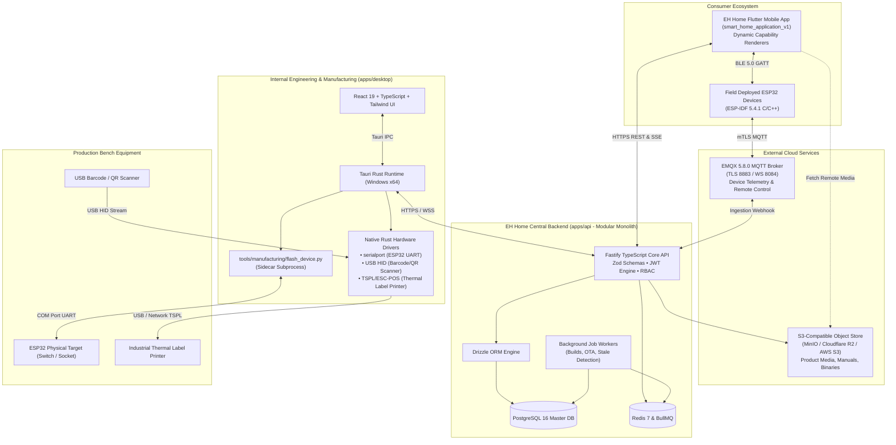

# EH Home — System Architecture

**Status:** APPROVED (Part 00 Baseline)  
**Author:** EH Home Engineering  
**Scope:** Complete Product Lifecycle, Engineering & Manufacturing Platform  

---

## 1. Top-Level Architectural Topology

EH Home operates as an integrated smart-home ecosystem linking internal engineering/manufacturing hardware with cloud intelligence and consumer mobile clients.

---

## 2. Source of Truth Matrix

| Domain | Primary Source of Truth | Secondary / Cache |
| :--- | :--- | :--- |
| **Firmware Source Code** | GitHub Repository (`firmware/`) | Local Git Workspace |
| **Business, Device & Batch Data** | PostgreSQL 16 (via Drizzle ORM) | Redis In-Memory Cache |
| **Firmware Binaries & Media Assets**| S3-Compatible Object Store (MinIO/R2) | Local Desktop / App Cache |
| **API & Protocol Contracts** | `packages/contracts/` (Zod + Schemas)| Shared TypeScript Package |
| **Manufacturing Provisioning Rules**| Central Backend Database | Desktop Staging Buffer |
| **Active Field Device State** | PostgreSQL `device_state` + Shadow | MQTT Ingest Engine |

---

## 3. Technology Stack Pinning

- **Desktop App:** Tauri v2, Rust 1.80+, React 19, TypeScript 5.x, Tailwind CSS v3/v4.
- **Central API:** Node.js v24 LTS, Fastify v4/v5, TypeScript 5.x, Drizzle ORM, Zod v3.
- **Database:** PostgreSQL 16 (strict relational integrity, JSONB for capability matrices).
- **Queues & Caching:** Redis 7, BullMQ v5.
- **Object Storage:** MinIO (Local Dev/CI), Cloudflare R2 / AWS S3 (Production).
- **Mobile Client:** Flutter 3.29+ / Dart 3.7+ (`smart_home_application_v1`).
- **Firmware Framework:** ESP-IDF v5.4.1 pinned (C/C++).
- **Package Manager:** `pnpm` workspaces for JavaScript/TypeScript projects.
