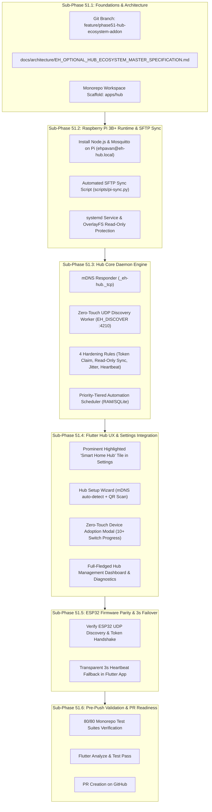

# Phase 51: EH Smart Home Hub Ecosystem Addon — Master Implementation Plan

**Branch:** `feature/phase51-hub-ecosystem-addon`  
**Target Base:** `main`  
**Classification:** Core Subsystem Architecture, Hardware SBC Integration, Mobile UX & Systems Engineering  
**Scope:** Semi-Production Hub Integration (Raspberry Pi 3B+ Baseline $\to$ Custom SBC Production Path), Zero-Touch Standalone Device Adoption, Dedicated Flutter Settings & Management Screen, Failover Parity.

---

## 1. Executive Strategy & Guiding Principles

1. **Zero Disruption to Existing Standalone Homes:**  
   Every existing switch and standalone app flow continues working 100% normally. The Hub is strictly an optional accelerator.
2. **Zero-Touch Adoption:**  
   When a customer buys an EH Hub, they never touch, unscrew, or reset existing wall switches. The Hub discovers and adopts all 10+ switches over LAN in $<2$ seconds.
3. **Dual Hardware & Software Progression in Parallel:**  
   App development (Flutter) and hardware/SBC development (Pi 3B+ / Node.js daemon) proceed in lockstep with zero architectural gaps.
4. **Credit / Token Efficiency & Code Reuse:**  
   Do not rewrite modules from scratch. The Hub runtime reuses the existing backend contracts (`packages/contracts`), REST schemas, and routine structures from `backend/src/`. Files are synced directly to the Pi via automated SFTP tooling.

---

## 2. Phase 51 Sub-Phases Roadmap

---

## 3. Sub-Phase Details & Work Breakdown

### Sub-Phase 51.1: Foundations & Architecture
- Branch created: `feature/phase51-hub-ecosystem-addon`.
- Master architecture documented in `EH_OPTIONAL_HUB_ECOSYSTEM_MASTER_SPECIFICATION.md`.
- Monorepo package scaffold created under `apps/hub/`.

### Sub-Phase 51.2: Raspberry Pi 3B+ Runtime & SFTP Sync
- Target: `ehpavan@eh-hub.local` (`192.168.0.174`).
- Environment: Debian GNU/Linux 13 (trixie) aarch64, 1GB RAM.
- Tasks:
  - Setup Node.js LTS, npm, Mosquitto broker, and Avahi.
  - Create `scripts/sync-hub-to-pi.py` using Paramiko to mirror code without manual rewriting.
  - Create `eh-hub.service` systemd unit for automated startup on boot.

### Sub-Phase 51.3: Hub Core Daemon Engine (`apps/hub/src/`)
- Fastify/Node.js lightweight HTTP API:
  - `/api/v1/hub/info` — Hub telemetry, uptime, memory, version.
  - `/api/v1/hub/adopt` — Trigger zero-touch discovery of existing LAN switches.
  - `/api/v1/control` — Forwarding actuator command to switches in $<5\text{ms}$.
  - `/api/v1/routines` — Priority-tiered scheduler handling standard rules.
- UDP Discovery Worker: Listens on port 4210, broadcasts `EH_DISCOVER` with home claim token.
- Non-disruptive state sync: `GET /api/v1/state` ensuring zero relay clicking during adoption.

### Sub-Phase 51.4: Flutter Hub UX & Settings Integration
- **Settings Screen (`settings_page_rebuild.dart`):**
  - Add a dedicated, highlighted **Smart Home Hub** tile.
  - Dynamic badge:
    - *No Hub:* Highlighted chip `Add Hub` (amber/blue) with subtitle *"Boost speed & enable 100% offline automations"*.
    - *Hub Active:* High-contrast emerald chip `🟢 Local Hub Active` with latency badge (`3ms`).
- **Hub Management Screen (`hub_management_page.dart`):**
  - **State A (Unlinked):** Onboarding wizard explaining benefits, one-tap mDNS discovery of `eh-hub.local`, and QR scanner.
  - **State B (Adopting):** Animated adoption modal showing real-time adoption of 10+ home devices with 100% progress.
  - **State C (Managed):** Complete Hub Dashboard:
    - Connected devices topology list (with switch models, signal, response time).
    - Offline automations list & priority breakdown (Standard vs Critical).
    - Hub health metrics: CPU, RAM, uptime, NTP sync status, OverlayFS SD protection.
    - Quick actions: *Re-scan Subnet*, *Sync Automations*, *Restart Hub Core*.

### Sub-Phase 51.5: ESP32 Firmware & Failover Validation
- Test zero-touch discovery response from FreeRTOS firmware.
- Verify that cutting Hub power causes Flutter app to fall back to Direct Device mode within 3 seconds.

### Sub-Phase 51.6: Quality Gates & PR
- Validate repo tests (`node scripts/validate-repo.js`).
- Validate Flutter analyzer (`flutter analyze`).
- Commit and prepare PR for review.

