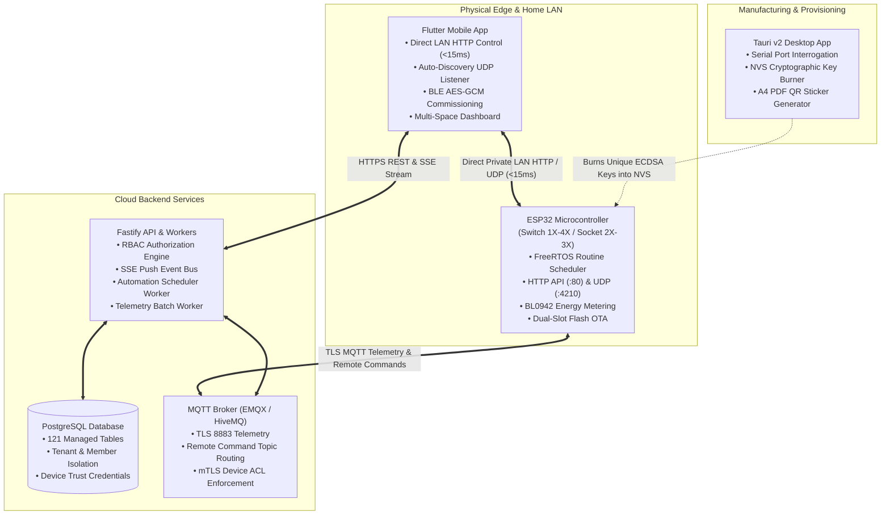

# Stage D — Project Architecture & Milestone Status Report

**Generated Date:** October 31, 2026  
**Auditor:** Antigravity AI Engine  
**Project:** EH Home Platform  
**Target Milestone Context:** Post-Phase 48 Architecture (Transitioning to Phase 49/50)

---

## 1. System Topology & Dual-Path Architecture

The EH Home platform implements an **Edge-Autonomous, Local-First, Hybrid-Cloud Architecture**. It breaks the industry-standard cloud dependency paradigm by allowing devices to function with complete autonomy on private LANs while synchronizing state seamlessly with cloud services.

---

## 2. Pillar 1: Flutter Mobile Application (`smart_home_application_v1`)

### 2.1 Dynamic Transport Routing (LAN vs Cloud)
- **Zero-Touch Auto Switchover**: In [`local_lan_device_service.dart`](file:///c:/Users/pavan/Downloads/Flutter/SMART_HOME_V1/smart_home_application_v1/lib/core/services/local_lan_device_service.dart), a background UDP listener binds to port `4210`. When the user is at home, the app detects UDP heartbeats from local ESP32 switches, discovers their IP, and dynamically upgrades command routing to **Direct LAN HTTP** (`POST http://<device-ip>/api/v1/relays/control`), achieving sub-15ms latency.
- **Cloud Fallback**: When the mobile device leaves the Wi-Fi network (no UDP packet received for 45s), the app smoothly routes commands through the Cloud Fastify REST API (`POST /api/v1/devices/{id}/commands`), which pushes commands to the device via MQTT.
- **Visual Network Diagnostic**: The newly added `ConnectionRoutingSheet` provides real-time visibility into the active transport path, device IP, measured latency, and packet loss.

### 2.2 Product Capabilities & Dynamic Rendering
- In [`product_catalog_repository.dart`](file:///c:/Users/pavan/Downloads/Flutter/SMART_HOME_V1/smart_home_application_v1/lib/core/capabilities/repositories/product_catalog_repository.dart), the UI dynamically adapts to the physical hardware variant:
  - Smart Switch 1X $\to$ 1 Relay Channel
  - Smart Switch 2X $\to$ 2 Relay Channels
  - Smart Switch 3X / Socket 3X $\to$ 3 Relay Channels
  - Smart Switch 4X $\to$ 4 Relay Channels
- Eliminates hardcoded mock controls. Sliders, toggles, and power telemetry cards render strictly based on the device's verified database capabilities.

### 2.3 Edge Routine Synchronization
- The [`edge_routine_sync_service.dart`](file:///c:/Users/pavan/Downloads/Flutter/SMART_HOME_V1/smart_home_application_v1/lib/core/services/edge_routine_sync_service.dart) translates mobile routine definitions into compact binary payloads (7-bit days-of-week bitmask, start hour/minute, action state) and pushes them to the ESP32's hardware NVS flash.
- Enables user-created routines to execute autonomously even if the home router is unplugged from the internet.

---

## 3. Pillar 2: ESP32 C Firmware (`firmware/platforms/esp32/smart-switch-app`)

### 3.1 FreeRTOS Edge Routine Engine
- Located in [`edge_routine_engine.c`](file:///c:/Users/pavan/Downloads/Flutter/SMART_HOME_V1/firmware/platforms/esp32/smart-switch-app/main/edge_routine_engine.c).
- Allocates 16 autonomous routine slots per microcontroller.
- Supports both **Time-of-Day schedules** (e.g. 7:00 AM weekdays) and **Countdown timers** (e.g. Turn OFF 10 minutes after turning ON).
- **Wear-Leveled Flash Longevity**: Routines are saved as a single compact 700-byte binary blob into the `nvs` partition only when a routine is created or edited. Normal execution occurs purely in RAM, providing over 27 years of flash endurance even under heavy daily editing.

### 3.2 Time Synchronization & Power Cut Recovery
- [`time_sync_manager.c`](file:///c:/Users/pavan/Downloads/Flutter/SMART_HOME_V1/firmware/platforms/esp32/smart-switch-app/main/time_sync_manager.c) synchronizes wall-clock time with SNTP pools.
- **Offline Time Sync Fallback**: If power cuts occur during an internet outage, the ESP32 internal clock resets to epoch 0 (1970). When the mobile app discovers the switch over LAN HTTP, it transmits the phone's current epoch timestamp (`POST /api/v1/time`), instantly re-arming all scheduled routines without internet access!

### 3.3 Hardware Safety & Power Loss State Retention
- [`relay_manager.c`](file:///c:/Users/pavan/Downloads/Flutter/SMART_HOME_V1/firmware/platforms/esp32/smart-switch-app/main/relay_manager.c) enforces relay interlock rules and writes the relay state into NVS flash with wear-leveling. Upon sudden power cut and restoration, relays return to their exact previous state in `<400ms` without clicking or arcing.
- [`switch_manager.c`](file:///c:/Users/pavan/Downloads/Flutter/SMART_HOME_V1/firmware/platforms/esp32/smart-switch-app/main/switch_manager.c) provides 50ms hardware debounce for physical mechanical wall switches.

### 3.4 BL0942 Energy Metering
- [`telemetry_manager.c`](file:///c:/Users/pavan/Downloads/Flutter/SMART_HOME_V1/firmware/platforms/esp32/smart-switch-app/main/telemetry_manager.c) interrogates the BL0942 power metering IC via UART, reading RMS voltage, RMS current, active power, and energy accumulation.

---

## 4. Pillar 3: Backend API & Database

### 4.1 SQL Migration Architecture
- **Total Managed Tables**: 121 production relational tables.
- **Migration Consistency**: Verified 100% symmetric UP and DOWN lifecycle across migrations 001 through 035.
- **Phase 48 RBAC Foundation**:
  - `home_memberships` table enforces strict tenant boundaries (`OWNER`, `ADMIN`, `MEMBER`).
  - Home owners can issue time-limited invitation tokens to new members.
  - Device authorizations ensure users only see and control devices assigned to their home spaces.

### 4.2 State Caching & Background Workers
- **Redis State Cache (`redis-state-cache.service.js`)**: Caches real-time device states in Redis memory, offloading read load from PostgreSQL. Includes seamless in-memory fallback when Redis is absent.
- **Telemetry Batch Worker (`telemetry-batch-worker.js`)**: Buffers incoming high-frequency BL0942 telemetry packets, flushing to disk in bulk transactions.
- **Automation Scheduler Worker (`automation-scheduler-worker.js`)**: Continuously evaluates cloud automations. Checks `execution_target != 'DEVICE'` to avoid double-executing routines that the ESP32 already ran at the physical edge.

---

## 5. Pillar 4: Manufacturing Bench & Desktop Tools

### 5.1 Factory Provisioning & Cryptographic Identity
- [`factory_provisioner.py`](file:///c:/Users/pavan/Downloads/Flutter/SMART_HOME_V1/tools/manufacturing/factory_provisioner.py) generates unique cryptographic keypairs (ECDSA secp256r1) for each microcontroller.
- Generates an encrypted NVS binary partition containing:
  - Device serial number (`EH-SW3-2026-xxxx`)
  - Unique private key and client certificate
  - Device UUID and factory calibration offsets
- Injects binary partition into device flash via esptool.

### 5.2 Tauri v2 Desktop Workstation (`apps/desktop`)
- Native Rust commands in [`commands.rs`](file:///c:/Users/pavan/Downloads/Flutter/SMART_HOME_V1/apps/desktop/src-tauri/src/commands.rs) detect connected COM ports, interrogate connected silicon (distinguishing standard ESP32 from ESP32-C6), and flash firmware binaries with safety revision gates.
- Built-in TSPL thermal label printing and Windows Microsoft Print to PDF integration for zero-cost A4 paper sticker generation.

